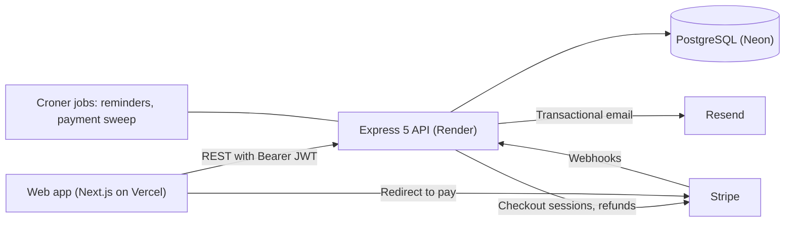
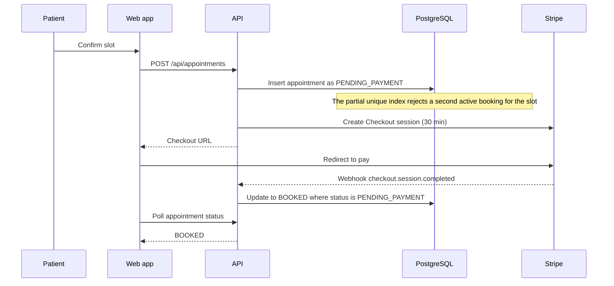
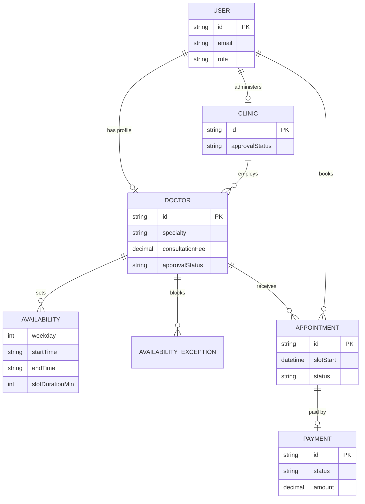

# CarePoint Server

REST API for CarePoint, a doctor appointment platform. Patients book real, conflict-free time slots and pay online, doctors and clinics manage their schedules, and admins review who goes live.

- **Live API:** <https://carepoint-server-xwsq.onrender.com> (free tier, so the first request after idle can take up to a minute)
- **Web app:** <https://carepoint-client.vercel.app>
- **Client repository:** <https://github.com/tawchifulislam/carepoint-client>

## What it does

- **Books without double-booking.** Slots are computed from each doctor's weekly rules, leave days and existing bookings, and the database itself rejects a second active booking for the same slot.
- **Takes payment safely.** A slot is held while the patient pays through Stripe Checkout. Confirmation, expiry and refunds are idempotent and survive missed webhooks.
- **Serves four roles.** Patients, doctors, clinic admins and super admins, with ownership checked on every record.

## Key decisions

**Slots are computed on read, not stored.** Availability is a set of weekly rules plus leave days. A slot list is derived per request for a bounded date window, so there is no slot table to keep in sync when a rule changes. The cost is a little computation per request, which stays small because the window is at most a week or two. The logic lives in `src/services/scheduling.service.ts`.

**The database arbitrates double bookings.** A partial unique index on `(doctorId, slotStart)` covering the statuses `PENDING_PAYMENT`, `BOOKED` and `COMPLETED` makes a second active booking for the same slot impossible. The API catches the violation (Prisma `P2002`) and returns `409`. I chose this over `SELECT ... FOR UPDATE` because a constraint cannot be forgotten in a new code path. A test fires two simultaneous bookings for one slot and asserts exactly one succeeds.

**The index is partial on purpose.** My first version used a plain unique constraint, which kept cancelled slots blocked forever. Limiting the index to active statuses lets a cancelled slot be booked again. It is added by hand in a raw SQL migration because Prisma's schema language cannot express partial indexes.

**A slot is held while the patient pays.** The appointment is created as `PENDING_PAYMENT` before checkout, so nobody else can take the slot. The Stripe Checkout session lasts 30 minutes, which is Stripe's minimum, and the hold ends with it.

**Payment confirmation does not depend on one webhook.** Three paths confirm a booking, and all of them use the same conditional update (`WHERE status = 'PENDING_PAYMENT'`), so they are safe to run in any order or twice:

1. the Stripe webhook (`checkout.session.completed`, with `checkout.session.expired` releasing the slot),
2. the status page, which asks the API to check the Stripe session when a patient returns,
3. a sweep every 10 minutes that reconciles stale holds against Stripe.

An out-of-order `expired` event arriving after `completed` is ignored.

**Refunds are refund-first and idempotent.** Cancelling calls Stripe with an idempotency key (`refund-<appointmentId>`) and only then updates the database in one transaction. If Stripe fails, the appointment stays booked and the user can retry. An already-refunded charge counts as success. The earlier order, status first and refund second, could cancel an appointment without returning the money.

**Authorization is deny-by-default and enforced in the query.** Records are fetched with the owner in the `where` clause (`{ id, doctorId }`, `{ id, patientId }`), so another user's record is simply not found. Roles are read from the database on every request instead of being trusted from the token, so a revoked doctor loses access immediately. Responses are shaped with `select` so private fields, such as another user's email or payment references, never leave the server.

**Auth uses bearer tokens because the client and API live on different domains.** Better Auth issues a long-lived session token. The client exchanges it for a 15-minute JWT that the API verifies against the JWKS with issuer and audience checks. Cookies would not travel between `vercel.app` and `onrender.com`. Google sign-in redirects through a one-time token handoff for the same reason. Password reset links are single use, expire in 30 minutes, never reveal whether an email exists, and sign the user out everywhere.

**All times are stored in UTC and interpreted in the clinic's time zone.** Opening hours are entered in `Asia/Dhaka` and converted with `date-fns-tz`. Day boundaries, such as which date a late-night slot belongs to, are computed in the clinic's zone.

**Reports use raw SQL where it is clearer.** The clinic dashboard aggregates revenue by doctor and by Bangladesh-local day in SQL. Reminders run on Croner every 15 minutes and at startup, using a conditional update so an email is never sent twice.

## Bugs found and fixed

| Problem | Fix |
| --- | --- |
| Cancelled slots could never be rebooked | Partial unique index instead of a plain one |
| Cancelling twice could refund twice | Status guard with a conditional `updateMany`, and refund-first with an idempotency key |
| A clinic admin with a pending clinic could approve doctors | Approval requires the owning clinic to be `APPROVED` |
| Slot dates were off by a day late at night | Date keys always computed in the clinic time zone |
| Webhook events arriving out of order | Conditional updates, so a late `expired` cannot undo a paid booking |
| Patient responses leaked the doctor's email and payment details | `select`-based responses and a privacy test |
| Doctors were sorted by revenue as text, so 9 ranked above 10 | Sort on the numeric sum |
| A doctor's list showed the oldest appointments first | `scope=schedule` and `scope=history` with explicit ordering |
| Booking depended on a single webhook delivery | Sync-on-visit and the sweep |
| Approvals had no state rules, and unknown ids returned `500` | Explicit transitions, `404`s, and a revoke guard while bookings exist |

## Architecture





### Data model



Roles: `PATIENT`, `DOCTOR`, `CLINIC_ADMIN`, `SUPER_ADMIN`. Appointment statuses: `PENDING_PAYMENT`, `BOOKED`, `COMPLETED`, `CANCELLED`, `NO_SHOW`. Better Auth also owns the session, account, verification and JWKS tables.

## API overview

| Area | Endpoints | Access |
| --- | --- | --- |
| Health and stats | `GET /health`, `GET /api/stats` | Public |
| Auth (Better Auth) | `/api/auth/sign-up/email`, `/sign-in/email`, `/token`, `/request-password-reset`, `/reset-password`, `/sign-in/social` | Public |
| Google handoff | `GET /api/oauth/handoff`, `POST /api/auth/one-time-token/verify` | Session cookie, then one-time token |
| Profile | `GET /api/me` | Signed in |
| Browse | `GET /api/doctors`, `GET /api/doctors/:id`, `GET /api/doctors/:id/availability`, `GET /api/clinics` | Public |
| Patient bookings | `POST /api/appointments`, `GET /api/appointments/me`, `GET /api/appointments/:id`, `PATCH /api/appointments/:id/cancel`, `PATCH /api/appointments/:id/reschedule`, `POST /api/appointments/:id/resume-payment`, `POST /api/appointments/:id/sync-payment` | Owner |
| Onboarding | `POST /api/clinics`, `POST /api/doctors` | Patient |
| Doctor portal | `/api/doctors/me/availability` (GET, POST, DELETE `/:id`), `/api/doctors/me/exceptions` (GET, POST, DELETE `/:id`), `GET /api/doctors/me/appointments?scope=schedule\|history`, `PATCH /api/doctors/me/appointments/:id/status`, `PATCH /api/doctors/me/appointments/:id/cancel` | Approved doctor |
| Clinic admin | `GET /api/clinics/me`, `/me/doctors`, `/me/dashboard?range=7d\|30d\|90d\|all`, `/:id/dashboard` | Clinic admin, super admin |
| Admin | `GET /api/admin/clinics`, `GET /api/admin/doctors`, `PATCH /api/admin/clinics/:id/approval`, `PATCH /api/admin/doctors/:id/approval`, `GET /api/admin/metrics` | Super admin, clinic admin for their own doctors |
| Payments | `POST /api/payments/webhook` | Stripe signature |

## Tests

The suite runs against a real PostgreSQL database (a separate `carepoint_test`). Stripe and Resend are mocked, and route tests replace authentication with a fake user, except the password reset and Google handoff tests, which run the real Better Auth handler.

Covered: simultaneous booking of one slot, cross-user access (IDOR) on appointment and portal endpoints, webhook idempotency and out-of-order delivery, sync and sweep recovery, refund failure leaving a booking intact, approval transitions and revoke guards, dashboard ranges and time zone bucketing in SQL, and password reset including the open-redirect guard and rate limit.

```bash
npx dotenv -e .env.test -- npx prisma migrate deploy
npx vitest run
```

GitHub Actions runs lint, build and the full suite on every push, with the tests running against a fresh PostgreSQL service container.

## Performance

The seed script creates 120 doctors and 2,382 appointments. Lists are paginated on the server with capped page sizes. Indexes cover the main access paths: appointments by `patientId`, by `(doctorId, status)` and by `(status, reminderSentAt, slotStart)`, doctors by `clinicId` and by `(approvalStatus, specialty)`, plus the partial unique index above.

I have not yet measured query plans or response times, so this README does not claim any. That is a next step.

## Setup

Requirements: Node 22 or newer, a PostgreSQL database, the Stripe CLI, and Resend and Stripe test keys.

```bash
git clone https://github.com/tawchifulislam/carepoint-server.git
cd carepoint-server
npm install
cp .env.example .env
npx prisma migrate deploy
npx prisma db seed
npm run dev
```

The migrations include the raw SQL partial index. Seeded users have no password, so they cannot sign in. Create real accounts through the app.

### Environment variables

| Variable | Purpose |
| --- | --- |
| `DATABASE_URL` | PostgreSQL connection string |
| `BETTER_AUTH_SECRET` | Signs sessions and encrypts the stored JWT key (must match across servers sharing a database) |
| `BETTER_AUTH_URL` | Public URL of this API |
| `CLIENT_URL` | Exact origin of the web app, used for CORS, trusted origins, Stripe return links and email links |
| `STRIPE_SECRET_KEY` | Stripe key (test mode) |
| `STRIPE_WEBHOOK_SECRET` | Signing secret of the webhook endpoint or `stripe listen` session |
| `RESEND_API_KEY`, `EMAIL_FROM` | Transactional email |
| `GOOGLE_CLIENT_ID`, `GOOGLE_CLIENT_SECRET` | Google sign-in (optional) |
| `PORT` | Defaults to 4000 |
| `LOG_RESET_LINKS` | Set to `true` in local development to print password reset links |

### Stripe in test mode

Use the test card `4242 4242 4242 4242` with any future expiry and any CVC. Locally, forward webhooks with the Stripe CLI and put the `whsec_` value it prints into `.env`:

```bash
stripe listen --events checkout.session.completed,checkout.session.expired --forward-to localhost:4000/api/payments/webhook
```

## Deployment and CI

The API runs on Render with `npm ci --include=dev && npx prisma generate && npx prisma migrate deploy && npm run build` as the build command and `node dist/index.js` as the start command, with a health check on `/health`. The database is Neon. The workflow in `.github/workflows/ci.yml` has three jobs: lint, build and test.

## Project structure

```text
prisma/
  schema.prisma
  seed.ts
  migrations/            includes the raw SQL partial index
src/
  app.ts                 Express app, exported for supertest
  index.ts               server start, schedulers, graceful shutdown
  controllers/           request handling
  routes/                routing and role guards
  services/
    scheduling.service.ts   slot computation and reservation
    payment.service.ts      Stripe sessions and reconciliation
    payment-sweep.service.ts
    appointment-cancellation.service.ts
    email.service.ts
    reminder.service.ts
  middlewares/           authenticate, authorize, error handling
  lib/                   auth, prisma, stripe, resend, validators
  test/                  auth test helpers
```

## Limitations and next steps

- **Cold starts on the free host.** The first request after 15 idle minutes can take up to a minute, and the reminder and sweep jobs only run while the service is awake. Next step: an always-on instance or an external scheduler.
- **Email only reaches the account owner** until a sending domain is verified in Resend. Next step: verify a domain.
- **No emails for clinic or doctor approval decisions**, and a rejected applicant cannot reapply. Next step: both.
- **Seeded appointments carry fake payments**, so cancelling them fails at the refund step by design.
- **Search uses a case-insensitive substring match**, which cannot use a regular index. Next step: a trigram index, after measuring query plans.
- **No structured logging or error tracking yet.** Next step: structured logs and Sentry.
- **No account deletion or data export.** Next step: both, before real use.
- **Stripe runs in test mode only.**
